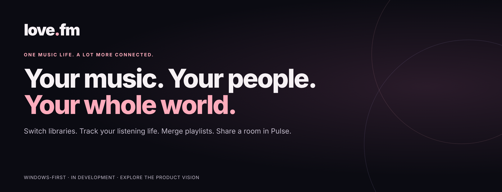
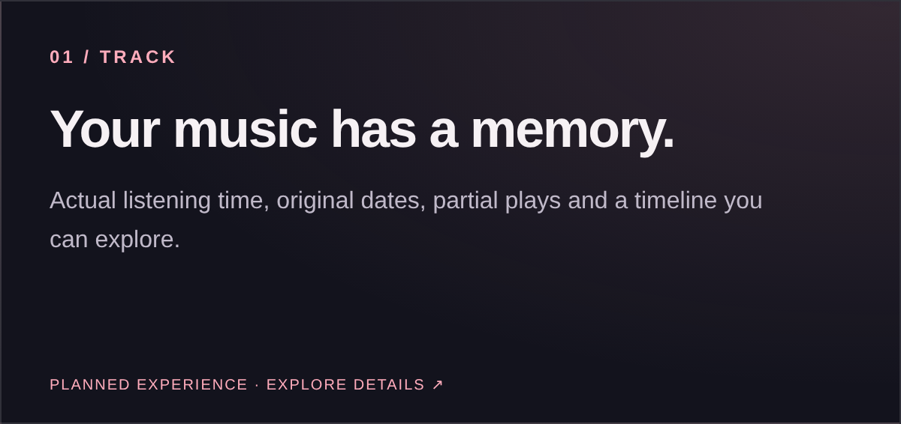
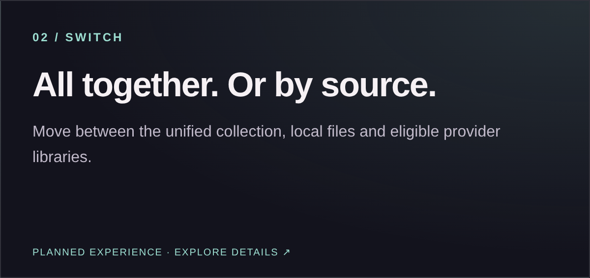
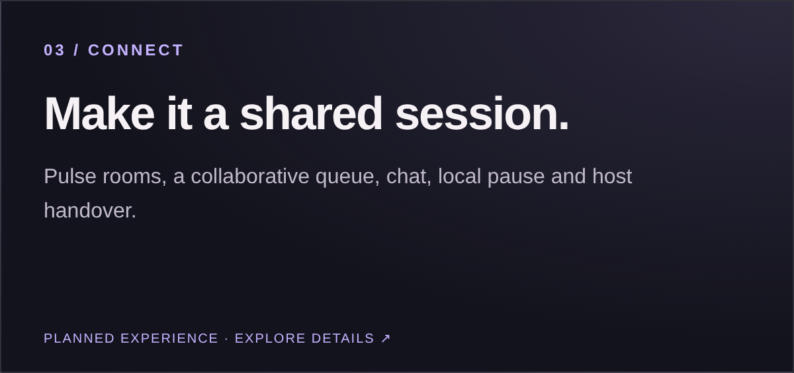
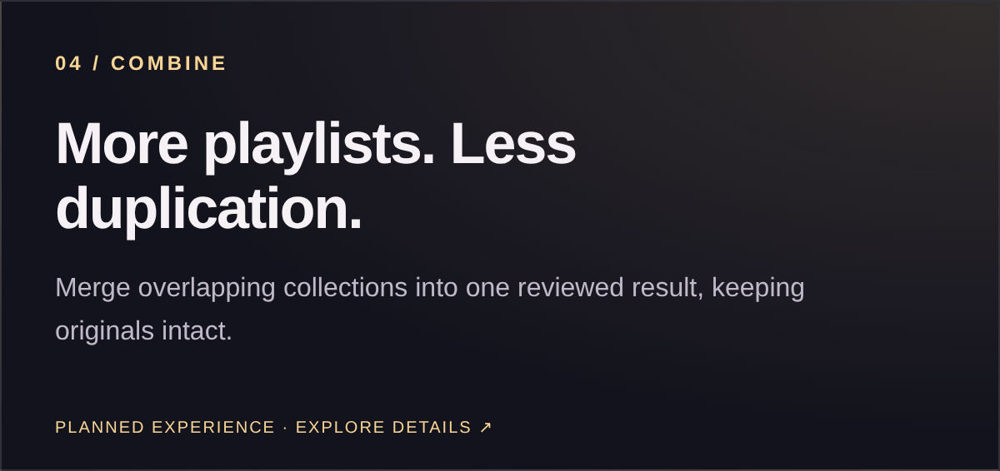
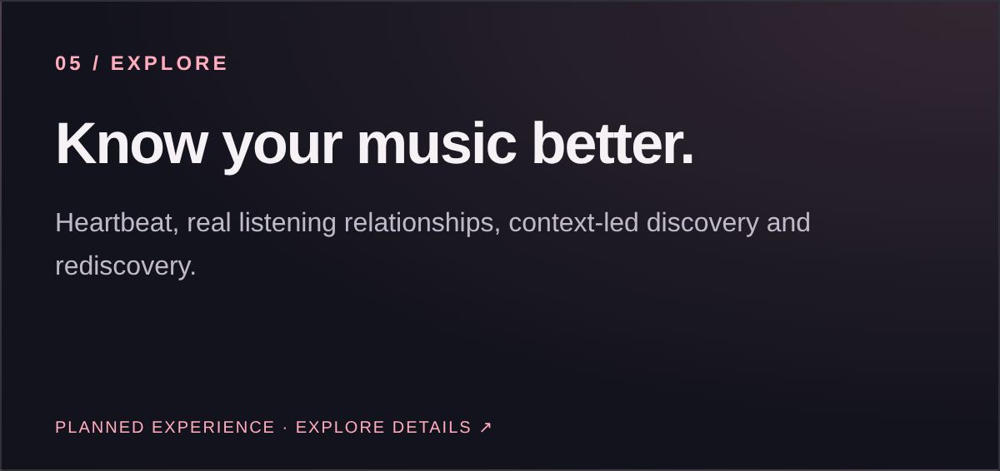
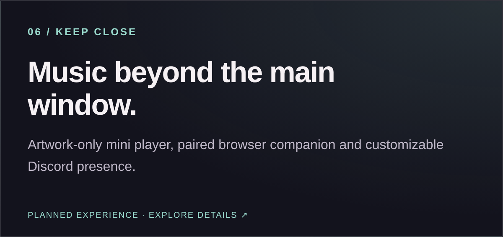

### Switch libraries. Track your listening life. Merge playlists. Share a room in Pulse.

**[Explore every feature](docs/FEATURES.md) · [Roadmap](docs/ROADMAP.md) · [Development progress](docs/PROGRESS.md) · [FAQ](docs/FAQ.md)**

[Open the visual Love portal ↗](https://kantwonet.github.io/love-fm/)

> **In development.** The features below describe Love’s intended experience—not a released checklist. Source-specific capabilities require permission and validation. This is a public showcase; the application source is private and no installer is offered here.

## One music life. A lot more connected.

Love is being built as a free, ad-free home for the files you own, the libraries you connect, the history you keep, the playlists you shape and the people you listen with. **The ambition is not just “all your music in one app.” It is making these experiences work together without losing their meaning.**

<table>
<tr>
<td width="50%"></td>
<td width="50%"></td>
</tr>
<tr>
<td></td>
<td></td>
</tr>
<tr>
<td></td>
<td></td>
</tr>
</table>

### Track the listening—not just the play button

Actual listening time, qualified and partial plays, original imported dates, a correction history, On This Day and Time Machine. Heartbeat connects artists, albums and exact recordings with first/last listens, counts, trends and the plays behind each statistic. Optional **Your time with Love** keeps app foreground time separate from background music time.

### Switch sources without losing the collection

Browse **All sources**, a supported provider view or local music. Keep recording editions and playback choices visible. Link provider versions of a playlist intentionally, select the version you are editing and use track/album playback overrides without making a Library filter change the music already playing.

### Pulse: your room, your queue, your people

Invited shared sessions with contributor names/avatars, chat and approved media, **Pause for me**, separate room-pause permissions, host handover and reconnection. Keep the personal queue when joining; save heard/upcoming session music afterward. Everyone needs their own permitted access—Pulse is not rebroadcast audio or shared subscription entitlement.

### Copy, Sync, Save and Merge—different tools, clear choices

Copy once. Maintain selected one-way Sync routes. Save a mix snapshot or deliberately keep an export updated. Merge two or more finite inputs into a reviewed, deduplicated result, choosing the output and order while preserving originals. **Distinct recordings stay distinct; ordinary playlists can still intentionally repeat a song.** Two-way Mirror and live Merge are later scope.

### Make local music first-class

Watched folders, scan previews, drag-and-drop references, artwork, multidisc organization, missing-file relinking, persistent Love metadata edits and Open in folder. Removing something from the collection does not delete the audio. Validated file-tag write-back is a Preferred option, not an automatic rewrite of your files.

### Explore and stay in control

Search your music and permitted catalogs separately; find the playlists containing a song, or search for a tool like Merge. Discover and Rediscover add relevant new releases, Love Mixes, related stations, familiarity controls and explainable recommendations. **Music World** geography is Preferred and uses verified origin information—not guesses.

### More than the main window

A shared main/full-screen player, artwork-only always-on-top mini window, source-aware authorized lyrics and waveform/graph availability, quiet tray operation, optional file associations, paired browser observations and customizable Discord presence. Playback, observation, saving and sharing remain separate actions.

## The full scope, without the guesswork

| Explore | What is included in the product direction |
| :--- | :--- |
| [Library & source switching](docs/FEATURES.md#library) | Unified categories, source views, linked versions, recording identity, intentional repeats and remembered browsing. |
| [Local music](docs/FEATURES.md#local) | Folders, scans, unavailable-file recovery, covers, metadata and file controls. |
| [Playback & queues](docs/FEATURES.md#playback) | Source overrides, manual/context order, actual-history navigation, device choices and paused restart. |
| [History & tracking](docs/FEATURES.md#history) | Actual listened time, imports, corrections, manual scrobbles, historical views and optional personal usage. |
| [Heartbeat](docs/FEATURES.md#heartbeat) | Artist/album/track context and inspectable personal listening relationships. |
| [Discovery](docs/FEATURES.md#discovery) | New releases, related stations, Love Mixes, Rediscover and Preferred Music World. |
| [Search & shell](docs/FEATURES.md#search) | Collection/catalog/actions search, playlist membership, Home, onboarding, pins and Activity. |
| [Copy & Sync](docs/FEATURES.md#transfers) | Previewed transfers, explicit destination writes, conflict handling, Save to source and later Mirror. |
| [Merge](docs/FEATURES.md#merge) | Deduplicated finite combinations, source contributions, ordering and retained originals. |
| [Pulse](docs/FEATURES.md#pulse) | Shared session, source-aware access, queue attribution, roles, chat/media and continuity. |
| [Social](docs/FEATURES.md#social) | Profiles, generated avatars, relationships, messages, shared music, comparisons and audience controls. |
| [Lyrics & graphs](docs/FEATURES.md#lyrics) | Authorized timing/text, recording-matched waveform, truthful technical details and optional extra analyses. |
| [Desktop & Discord](docs/FEATURES.md#desktop) | Windows-first operation, mini window, browser pairing and sticky source-aware presence. |
| [Privacy & accounts](docs/FEATURES.md#privacy) | Guest core, private listening, isolated accounts, opt-in cloud scope and disclosed technical diagnostics. |
| [Design & performance](docs/FEATURES.md#design) | Love identity, Light/Dark/System, reduced motion, accessible controls and measured large-library targets. |
| [Recovery & support](docs/FEATURES.md#recovery) | Previewed recovery, safe updates, scoped support, responsible operation and release gates. |

**[Read the complete public feature guide →](docs/FEATURES.md)**

## Ambitious scope. Clear release boundaries.

**Launch direction:** core Library/local music, approved playback and queue paths, history/imports/scrobbling, Search/Heartbeat/discovery, applicable lyrics/graphs, core Social and Pulse, desktop integrations, Copy, one-way Sync, one-time Merge, privacy and recovery/support.

**Preferred, explicitly include or defer:** Music World, selected Love cloud sync, extra graphs, personal usage statistics, adaptive tips, validated file-tag writes, crossfade and taskbar artwork.

**Later:** two-way Mirror, live Merge, cloud-run jobs, Listen Along, persistent collaborative playlists and other platforms. Camera/screen sharing are deferred; voice remains an idea requiring a later decision.

Named providers are intended capability areas, not a claim that every integration is available. Free Love software does not supply third-party subscriptions. [See roadmap and dependencies](docs/ROADMAP.md).

## What is already earning acceptance?

The dated internal milestones include protected archive handling; one confirmed 25-row execution slice; rollover into a generated plan; correction of explicit database selection; and the bounded 500-row start/pause/resume/completion lifecycle. Some are implementation fixes and some are proof of existing behavior. **They are not an app-release claim or a complete recovery pass.**

[Progress](docs/PROGRESS.md) explains the scope and remaining work. [Engineering](docs/ENGINEERING.md) covers the safety foundation. We do not turn cumulative tests or the blueprint’s requirement count into a release-completion percentage.

---

**Your music deserves more than another tab.**

[Full feature guide](docs/FEATURES.md) · [Development progress](docs/PROGRESS.md) · [The vision](docs/VISION.md) · [Repository notice](NOTICE.md)

*Public presentation snapshot: 13 October 2026 · Product Blueprint 2.8. Decorative graphics are not app screenshots.*

